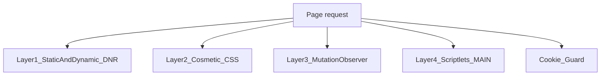

# AUVYQ 4-layer blocking audit and migration plan

**Important framing:** you already have the architecture. There is no `background.js` / `content.js`. The loadable extension is [`extension/dist/`](extension/dist/) built from [`extension/sw.ts`](extension/sw.ts) + [`extension/content/`](extension/content/). Reaching **>95%** is a **coverage** problem (and a few correctness bugs), not a missing-layer problem.

You chose **build-time compile of EasyList / EasyPrivacy / uBO lists** into static DNR JSON + cosmetic packs, with license/attribution. That matches Chrome MV3 limits better than compiling tens of thousands of filters in the service worker on first run.

---

## 1. Weakness analysis (what actually stops >95%)

### Coverage (primary reason you are nowhere near 95%)

| What ships today | Scale | Effect |
|---|---|---|
| Static DNR: [`rules/main.json`](extension/rules/main.json), [`rules/annoyances.json`](extension/rules/annoyances.json), [`rules/ads-trackers.json`](extension/rules/ads-trackers.json) | **60 rules**, ~150 batched domains | README itself calls `main`/`annoyances` **parser fixtures**. Domain batches miss most long-tail ad CDNs, obfuscated hosts, and first-party `/ads/` variants. |
| Dynamic pack: [`data/default-filters.txt`](extension/data/default-filters.txt) | **~24 network + duplicate cosmetics**, **zero `##+js()`** | Compiler/scriptlets exist but have **nothing to run**. |
| Builtin CSS in [`content/cosmetic-injector.js`](extension/content/cosmetic-injector.js) | ~80 high-precision selectors | Hides common GPT/AdSense/Taboola boxes; misses EasyList’s tens of thousands of site-specific `domain##` rules. |
| Cookies: [`data/cookie-classification.json`](extension/data/cookie-classification.json) | ~131 domains | Live delete + sweep only those suffixes; unknown trackers stay. |

EasyList-class blocking is typically **tens of thousands of network rules + tens of thousands of cosmetics + scriptlets**. Until those are compiled in at **build time**, the 4-layer engine cannot hit 95% on real pages.

### Layer mapping: current weak point → fix

| Layer | Current weak points (exact) | Needed fix |
|---|---|---|
| **1. Network DNR** | 60 static rules; default list too small; `modules.ads` / `modules.trackers` **do not** enable/disable rulesets (only `masterEnabled` in `syncNetworkBlocking`); site pause uses `initiatorDomains` only ([`adapter.ts` 132–139](extension/platform-chrome/dnr-adapter/adapter.ts)) so first-party ad requests on the paused site may still be blocked; `applyPackDiff` **adds all next IDs without removing overlapping existing IDs first** (DNR add-on-existing-id fails). | Build-time split static rulesets; wire module toggles; pause with `requestDomains` **or** `allowAllRequests` on `main_frame`+subresources; diff DNR by remove∪add of overlapping ids. |
| **2. Cosmetic CSS** | `GET_COSMETIC` treats `perDomain` as a **string**, but schema is `string[]` ([`packs.ts` 72–77](extension/core/cosmetic-engine/packs.ts), [`sw.ts` 596–599](extension/sw.ts)) — **site-specific pack CSS never injects**. `injectBuiltin()` waits on RPC ([`cosmetic-injector.js` 184–186](extension/content/cosmetic-injector.js)) despite comments saying document_start sync. `injectCss` sets `injected=true` even for empty CSS, so a later pack cannot apply. No hostname suffix match (`www` vs apex). Quota `demotedCss` is computed then **discarded** ([`sw.ts` 171–178](extension/sw.ts)). | Join `perDomain[host]` arrays; suffix match; inject builtin **before** RPC; merge demoted CSS into `genericCss`; ship compiled generic + per-host cosmetic index. |
| **3. MutationObserver** | Observer is created **only after** `GET_COSMETIC` resolves (SPA ads already inserted). Comment says it “always disconnects”; **it never `disconnect()`s**. Each added node runs `querySelectorAll` on up to **150 selectors** — O(mutations × selectors), bad on infinite scroll. Collapse uses inline `display:none` which can fight React and hide false positives. | Start observer immediately with builtin selectors; throttle/batch mutations; keep CSS as primary hide; observer only for leftover nodes; disconnect on `pagehide` / when ads module off. |
| **4. Scriptlets** | Default list has **no** `##+js()`. `GET_DISPATCH` looks up **exact host only** ([`sw.ts` 577](extension/sw.ts)); generic `'(generic)'` entries never apply. Cosmetic fires `auvyq-scriptlets` after async RPC; MAIN listener is fine **if** dispatch.js ran first, but registration order is cosmetic **then** dispatch ([`sw.ts` 82–85](extension/sw.ts)) — race on first paint. Content scripts are **not** in `manifest.json`; they depend on `registerContentScripts` after install/startup. | Compile supported uBO scriptlets into a host-indexed map at build time; suffix + generic merge; declare content scripts in the manifest at `document_start`; buffer events in `scriptlet-dispatch.js`. |
| **Cookies (extra)** | `handleCookieChanged` uses valid `{ url, name }`. **Sweep / tab cleanup / `REMOVE_COOKIES` use `{ name, domain }` which Chrome does not accept** ([`guard.ts` 108, 148](extension/platform-chrome/cookie-guard/guard.ts), [`sw.ts` 714](extension/sw.ts)) — dashboard Sweep and 1-minute alarm largely **no-op**. Sweep calls `cookies.getAll({})` every **1 minute** (wakes SW, scans every cookie). `TRACKER_COOKIE_PATTERN` includes `APISID` / `SAPISID` (Google auth-adjacent). Pause is keyed on **cookie domain**, not the tab’s site. | Always remove via reconstructed `url`; drop or lengthen sweep; never delete auth cookies; classify by name **and** domain; keep dashboard RPC shape. |

---

## 2. Code review: bugs, leaks, MV3 / permissions

**Confirmed bugs**

- **Per-domain cosmetics dropped** — `typeof domainCss === 'string'` vs `string[]`.
- **Demoted quota CSS unused** — `const demoted = quota.demotedCss` never merged.
- **Cookie remove API mismatch** — sweep, `cleanupForTab`, `REMOVE_COOKIES`.
- **Builtin cosmetics delayed** — FOUC / first-party ad iframes visible until SW answers.
- **`applyPackDiff` update hazard** — adding rules whose IDs already exist throws; rollback path is the only recovery.
- **`SET_SETTINGS` module flags** — toggling Ads/Trackers in Dashboard does not call `updateEnabledRulesets`; only cosmetics/scriptlets respect `modules.ads`.
- **Packed-build stats lie** — [`observer.ts`](extension/platform-chrome/request-observer/observer.ts) relies on `onRuleMatchedDebug` (unpacked only). `webRequest` observer never attaches (`webRequest` not in permissions). Dashboard counters undercount in production.

**Memory / performance**

- Cosmetic observer: unbounded lifetime + per-node `querySelectorAll` × 150.
- Cookie sweep: full-store scan every minute + `cookies.onChanged` (duplicate work).
- `GET_COOKIE_REPORT` / `getAll({})` on Dashboard Cookies tab — fine as user-triggered, not as an alarm.
- Compiling a large list **inside** `activatePackFromListText` on the SW would **timeout/kill** the worker. Do **not** compile EasyList at runtime.

**MV3 / permissions**

- Already MV3, SW listeners are top-level — good.
- Permissions are **broad but justified** for a blocker (`<all_urls>`, `cookies`, `scripting`, `declarativeNetRequest`). Not minimal for a simple popup, but appropriate for this product.
- **Do not add `webRequestBlocking`** (removed in MV3). Optional `webRequest` (non-blocking) only if you need tab-tracker host tracking; prefer DNR matched-rule telemetry where available.
- SW sleep: you already use `chrome.alarms`. Cookie sweep + 1-min stats flush keep the worker waking constantly — reduce cookie alarm to 30–60 **minutes** or event-only.
- Content scripts should be **manifest-declared** so they run even if the SW has not yet run `registerContentScripts`.

**Missing asset in source**

- [`tools/validate-resources.mjs`](extension/tools/validate-resources.mjs) requires `resources/1x1.gif`; it is **generated at build** by [`esbuild.mjs`](extension/esbuild.mjs) via `writeNoopGif`. Source tree without a prior build looks broken; `dist/` after `npm run build` is what Chrome should load.

---

## 3. Files to change / add / keep

**Do not delete** UI: [`ui/popup/`](extension/ui/popup/), [`ui/dashboard/`](extension/ui/dashboard/), [`ui/onboarding/`](extension/ui/onboarding/), [`ui/site-report/`](extension/ui/site-report/), [`ui/motion.css`](extension/ui/motion.css). They talk only via RPC (`GET_SNAPSHOT`, `SET_SETTINGS`, `SET_SITE_PAUSED`, `GET_COOKIE_REPORT`, `REMOVE_COOKIES`, …). Preserve those types in [`types/messages.ts`](extension/types/messages.ts) and Settings/Snapshot fields.

**Modify**

- [`extension/manifest.json`](extension/manifest.json) — version `0.2.0` → `0.3.0`; add `content_scripts`; add more `declarative_net_request.rule_resources`; optional `web_accessible_resources` already covers `resources/*`.
- [`extension/sw.ts`](extension/sw.ts) — fix cosmetic/dispatch/quota/cookie RPC; `STATIC_RULESET_IDS` list; module-aware ruleset enablement; **stop** compiling huge lists at runtime (keep `activatePackFromListText` for small default + signed hotfixes only).
- [`extension/platform-chrome/dnr-adapter/adapter.ts`](extension/platform-chrome/dnr-adapter/adapter.ts) — safe diff; pause rules.
- [`extension/platform-chrome/cookie-guard/guard.ts`](extension/platform-chrome/cookie-guard/guard.ts) — `url`-based remove; safer name denylist.
- [`extension/content/cosmetic-injector.js`](extension/content/cosmetic-injector.js) — sync builtin CSS; suffix cosmetics; observer hygiene.
- [`extension/content/scriptlet-dispatch.js`](extension/content/scriptlet-dispatch.js) — event buffer until listener ready.
- [`extension/package.json`](extension/package.json) — version + `compile-filters` script.

**Add (build-time pipeline + generated rules)**

- `extension/tools/compile-filters.mjs` — fetch/pin EasyList, EasyPrivacy, selected uBO lists; convert to DNR JSON + cosmetic/scriptlet packs; write license files.
- `extension/rules/` layout (generated, not hand-edited):
  - `rules/static/easylist-1.json` … split so each file stays under Chrome’s per-ruleset size and **enabled static ruleset** cap (Chrome 120: treat **10 enabled static rulesets** as the safe ceiling unless you raise `minimum_chrome_version` and re-check `MAX_NUMBER_OF_ENABLED_STATIC_RULESETS`).
  - `rules/static/easyprivacy.json`, `annoyances.json` (replace fixture or keep fixture as a tiny extra set).
- `extension/data/cosmetic/` — `generic.css` (or JSON of selectors) + `specific.json` (hostname → selectors), built at compile time.
- `extension/data/scriptlets/dispatch.json` — host → allowlisted scriptlets only (map uBO names onto your 15 in [`library.ts`](extension/core/scriptlet-engine/library.ts); **drop** unsupported `+js()`).
- `extension/licenses/` — EasyList / EasyPrivacy / uBO attributions (required for Web Store).
- `extension/vendor/lists/` — pinned list snapshots + hashes (reproducible builds).

**Keep as-is (small hotfix path)**

- [`data/default-filters.txt`](extension/data/default-filters.txt) — user/custom/hotfix overlay, not the 95% corpus.
- Existing parser/compiler — reuse for overlay + tests; do **not** run it on full EasyList inside the SW.

**Service worker organization (DNR + cookies together)**

Do not merge those APIs into one giant handler. Keep:

- Top-level listeners only (already true).
- A **single async mutex** around `updateDynamicRules` / `updateSessionRules` / `updateEnabledRulesets` (serialize DNR writes). Cookie `onChanged` must **not** await DNR; only `cookies.remove`.
- Cookie handler: classify → maybe remove → `stats.recordEvents` batched; never `getAll({})` on the hot path.
- Pack apply stays in `activatePackFromListText` with `activating` lock (already there).

---

## 4. Safe migration roadmap (UI stays up)

Do this in order so Dashboard / Settings / Cookies keep working after each step.

1. **Bugfix slice (still v0.2.x internally, ship as 0.3.0 together)**  
   Fix `GET_COSMETIC` array join + suffix hosts; merge `demotedCss`; inject builtin CSS immediately; cookie `remove({ url, name, storeId })`; `REMOVE_COOKIES` same; DNR diff overlap; `GET_DISPATCH` suffix + `(generic)`.  
   **Do not change RPC names or Snapshot fields** (`adsBlocked`, `trackersBlocked`, `cosmeticHidden`, `cookiesCleaned`, `privacyScore`).

2. **Manifest content_scripts**  
   Duplicate the four `CONTENT_SCRIPTS` entries into `manifest.json` `content_scripts` (ISOLATED + MAIN worlds). Keep `registerContentScriptsSafely` as a no-op/idempotent backup or remove after verifying install.

3. **Build-time list compiler**  
   Pin list URLs/versions. Convert network filters to DNR (`urlFilter` / `requestDomains` / `regexFilter` only when RE2-safe — you already have [`re2-validate.ts`](extension/core/rule-compiler/re2-validate.ts)). Split into ≤ enabled-ruleset count. Overflow → cosmetic fallback pack (same idea as `applyQuota`, but at **build** time, capacity ~30k guaranteed static rules).

4. **Wire new ruleset IDs**  
   Expand `STATIC_RULESET_IDS` in `syncNetworkBlocking`. Map `modules.ads` → easylist rulesets, `modules.trackers` → easyprivacy, annoyances → existing or uBO annoyances. Master-off still disables **all** + session allow `30000`.

5. **Cosmetic + scriptlet packs from the same compile**  
   Content script loads generic CSS from the compiled file (or a compact selector list) **without** waiting for SW. `GET_COSMETIC` only adds **specific** host CSS from storage or a chunked JSON import. Scriptlet map loaded the same way.

6. **Cookies**  
   Keep `GET_COOKIE_REPORT` / `REMOVE_COOKIES` payloads. Expand `cookie-classification.json` from EasyPrivacy domains at compile time if you want, still never delete `ESSENTIAL_COOKIE_PATTERN`. Slow the sweep alarm.

7. **Tests**  
   Extend [`tests/compiler.test.ts`](extension/tests/compiler.test.ts), quota, cookie-guard tests for `url` remove and perDomain arrays. Add a compile-filters dry-run that asserts rule counts and that `requestDomains` batches stay under Chrome’s domain-list limits.

8. **Version + load for testing**  
   - Set `"version": "0.3.0"` in [`extension/manifest.json`](extension/manifest.json) **and** [`extension/package.json`](extension/package.json) (keep them equal).  
   - Chrome Web Store / `chrome.runtime.onInstalled` `reason === 'update'` already runs `handleInstalled` → re-register scripts; add a one-shot “recompile not needed, static rulesets replaced on reload”.  
   - `cd extension && npm run build`  
   - Chrome → `chrome://extensions` → Developer mode → **Load unpacked** → select **`extension/dist`** (not the repo root).  
   - After code changes: rebuild, then **Reload** the extension; refresh open tabs (content scripts do not update until reload + tab refresh).  
   - Verify: popup master toggle still calls `SET_SETTINGS` → `syncNetworkBlocking`; Dashboard Protection modules still `SET_SETTINGS`; Cookies tab still `GET_COOKIE_REPORT` / `REMOVE_COOKIES`; site pause still `SET_SITE_PAUSED`.

**Do not** bump to 1.0.0 until list licensing and false-positive QA (especially `allowAllRequests` / first-party filters) are done.

---

## Honest 95% note

With EasyList + EasyPrivacy + a uBO cosmetics/scriptlet subset compiled at build time, **network+cosmetic coverage can approach EasyList-class rates** on typical news/blog sites. You will still miss: procedural cosmetic filters, many uBO scriptlets not in your 15-name allowlist, CNAME-cloaked first-party ads (needs extra DNR/`requestDomains` intelligence), and WebSocket/ad-in-video cases. Plan a follow-up to expand [`SCRIPTLET_LIBRARY`](extension/core/scriptlet-engine/library.ts) only with fixed, non-`eval` implementations.
