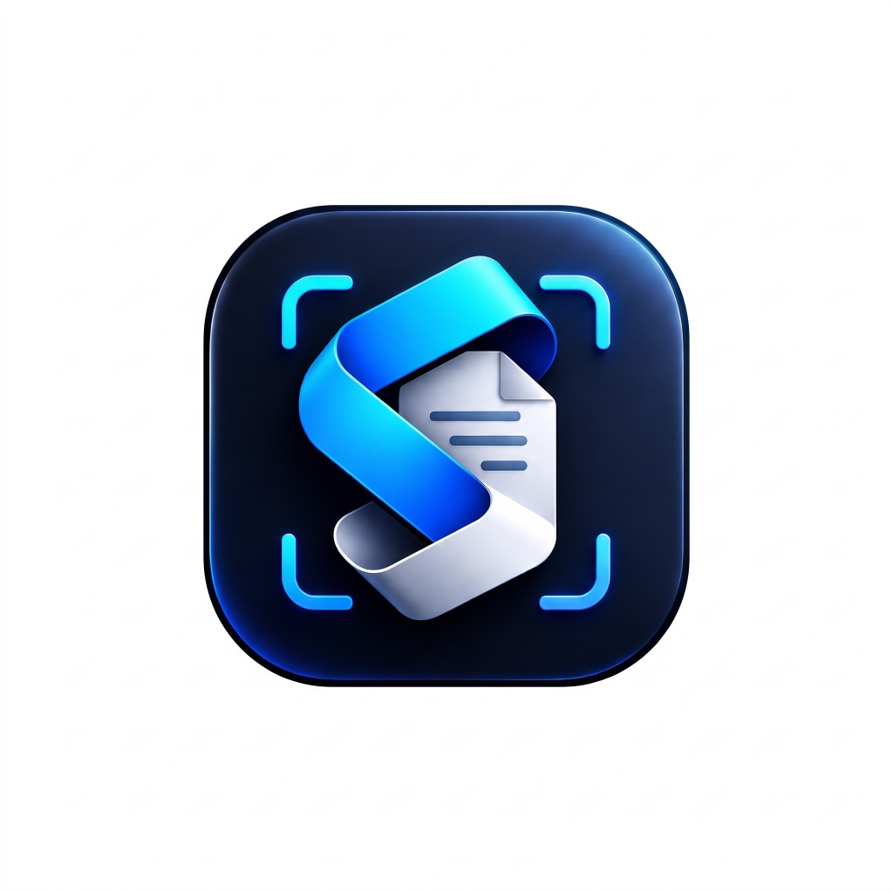

# Scaneliq — Document Scanner & PDF Productivity App

<p align="center">
  
</p>

<p align="center">
  <b>Scan documents. Keep everything organized.</b><br>
  A modern, Android-first, local-first document scanner and PDF productivity mobile application built with Flutter & Dart.
</p>

<p align="center">
  
  
  
  
  
</p>

---

## 📱 Download for Android (Beta Pre-Release)

Direct download links from GitHub Releases:
- 🚀 **[app-arm64-v8a-release.apk (40.9 MB)](https://github.com/md-aktaruzzman-emon/scaneliq-doc-scanner/releases/download/v1.0.0-beta.1/app-arm64-v8a-release.apk)** — **Recommended for modern 64-bit Android smartphones**
- 📦 **[app-release.apk (110.3 MB)](https://github.com/md-aktaruzzman-emon/scaneliq-doc-scanner/releases/download/v1.0.0-beta.1/app-release.apk)** — Universal compatibility APK
- 📋 **[বাংলা ইনস্টলেশন নির্দেশিকা (Bangla Installation Guide)](docs/ANDROID_INSTALLATION_BN.md)**
- 🏷️ **GitHub Release Page:** [Scaneliq 1.0.0 Beta 1 — Android](https://github.com/md-aktaruzzman-emon/scaneliq-doc-scanner/releases/tag/v1.0.0-beta.1)

---

## Overview

**Scaneliq** is an Android-first document scanning and PDF productivity application that takes paper documents through a complete, verified workflow:

$$\text{Capture / Import} \longrightarrow \text{Review / Reorder} \longrightarrow \text{Edit / Enhance} \longrightarrow \text{Generate PDF / JPEG} \longrightarrow \text{Local Persistence} \longrightarrow \text{View / OCR} \longrightarrow \text{Share / Export}$$

All core features operate **100% on-device** without requiring accounts, logins, or cloud telemetry. Scanned pages and document records remain strictly inside the app-private sandbox.

---

## Key Features

### 📸 Capture & Import
- **Hardware Document Scanner:** Integrated with Google ML Kit Document Scanner (`ScannerMode.full`), providing real-time edge detection, automatic perspective correction, and shadow reduction.
- **Multi-Format File Import:** Pick single or multiple image files (`.jpg`, `.jpeg`, `.png`, `.webp`) from device storage.
- **Atomic File Management:** Captured images are copied into app-private `originals/` storage safely before editing.

### 📑 Multi-Page Review & Organization
- **Visual Drag-and-Drop Reordering:** Easily rearrange pages using Flutter's `ReorderableListView`; new page orders persist immediately in SQLite and reflect in exported PDFs.
- **Page Retake:** Replace any individual page image with a fresh scan without altering the document structure.
- **Unfinished Draft Auto-Recovery:** In-progress scanning sessions are automatically persisted as drafts (`is_draft = 1`) in SQLite. A one-tap banner on the Home screen lets users resume interrupted scans at any time.

### 🎨 Non-Destructive Image Enhancement
- **Immutable Originals:** Captured files in `originals/` are never overwritten. Edits are tracked in an immutable `EditRecipe`.
- **Rotations:** Non-destructive 90° clockwise rotation increments.
- **Color Filters:** Original, Grayscale, and high-contrast Black & White document scan enhancement.
- **Brightness & Contrast Sliders:** Fine-tune readability with real-time adjustments (Brightness: -0.5 to 0.5; Contrast: 0.5 to 2.0).

### 📄 Validated PDF & JPEG Generation
- **Pure Dart PDF Engine:** Builds multi-page A4 documents with embedded JPEG compression and proper aspect containment.
- **Integrity Validation:** Exports are generated to temporary files (`.tmp`), verified for minimum byte size and the `%PDF-` magic header, and atomically renamed.
- **Single-Page JPEG Export:** Export any individual page directly as a processed JPEG with standard SOI header verification (`0xFFD8FF`).

### 🔍 In-App PDF Viewer & On-Device OCR
- **Built-in PDF Viewer:** Powered by `pdfrx` with smooth pinch-to-zoom, pan, and continuous multi-page scrolling.
- **On-Device Text Recognition:** Extract selectable text using Google ML Kit Text Recognition with zero network calls.
- **Copyable Text Sheet:** Copy extracted text to clipboard per page or across the whole document.
- **Instant Image OCR Tool:** Standalone utility to extract text from any image file on the device.

### 🗄️ Document Library & Management
- **SQLite Database:** Relational schema (`scaneliq.db`, schema version 2) with tables for `documents` and `pages`, indexes on `(document_id, page_order)` and `(modified_at DESC)`.
- **Search & Filter:** Real-time title search and favorites toggle (`is_favorite`).
- **Sorting Options:** Newest first, Oldest first, Name (A-Z), and Name (Z-A).
- **Safe Cascading Deletion:** Transactional deletion of database records combined with automated disk cleanup of associated PDF exports and page files.
- **System Share Sheet:** Export and share generated PDFs or JPEGs via Android's native share interface (`share_plus`).

---

## Material 3 Design & Branding

- **Official Brand Mark:** Preserved unaltered at `assets/branding/scaneliq_logo_original.jpg` (1024×1024 24bpp RGB image).
- **Android Launcher Icons:** Generated across all mipmap densities (`mdpi`, `hdpi`, `xhdpi`, `xxhdpi`, `xxxhdpi`, and adaptive `anydpi-v26`).
- **Color Palette:**
  - Primary Brand Blue: `#2563EB`
  - Deep Navy: `#173B8F`
  - Surface Background: Light `#F8FAFC` / Dark `#0F172A`
  - Accent / Error: `#DC2626` / Success: `#16A34A`
- **Typography:** Google Fonts Inter hierarchy with accessible touch targets and tooltips.

---

## Project Structure

```text
Scaneliq/
├── android/                         # Android native project (minSdk 21, compileSdk 36)
│   ├── app/build.gradle.kts         # Application Gradle configuration
│   └── src/main/AndroidManifest.xml # Manifest with CAMERA permissions & Scaneliq label
├── assets/
│   └── branding/                    # Official Scaneliq visual identity & logo
├── docs/
│   ├── Scaneliq_Master_Blueprint_Improved.md # Master technical & product specification
│   └── IMPLEMENTATION_STATUS.md     # Requirement-by-requirement verification matrix
├── lib/
│   ├── app/
│   │   └── main_navigation_shell.dart # 4-tab bottom navigation (Home, Docs, Tools, Settings)
│   ├── core/
│   │   ├── models/document_models.dart # Domain models (ScannedDocument, DocumentPage, EditRecipe)
│   │   ├── storage/app_storage_service.dart # Directory sandbox (originals, processed, exports, temp)
│   │   └── theme/app_theme.dart     # Material 3 centralized themes & color tokens
│   ├── features/
│   │   ├── documents/
│   │   │   ├── data/app_database_service.dart # SQLite database service, migrations, cascade deletes
│   │   │   └── presentation/        # HomeScreen, DocumentsLibraryScreen, DocumentViewerScreen
│   │   ├── editor/presentation/     # ReviewPagesScreen, EditPageScreen
│   │   ├── ocr/data/ocr_service.dart # ML Kit on-device text recognition
│   │   ├── pdf/data/pdf_service.dart # Pure Dart PDF builder, JPEG exporter, edit recipe pipeline
│   │   ├── scanner/presentation/    # ScanSessionNotifier & Riverpod state provider
│   │   └── settings/presentation/   # SettingsScreen, ToolsScreen
│   └── main.dart                    # Application entry point & ProviderScope
└── test/                            # 25 automated unit, widget, and persistence tests
    ├── database_persistence_test.dart
    ├── document_models_test.dart
    ├── edit_recipe_test.dart
    ├── navigation_and_screens_test.dart
    ├── pdf_generation_test.dart
    ├── storage_service_test.dart
    └── widget_test.dart
```

---

## Getting Started

### Prerequisites

- **Flutter SDK:** Version 3.47.7 or newer
- **Dart SDK:** Version 3.13.5 or newer
- **Java Development Kit:** JDK 17 (e.g. Eclipse Temurin 17)
- **Android SDK:** API 34+ (Build-Tools 36.0.0 / 28.0.3)

### Installation & Build

1. **Clone the repository:**
   ```bash
   git clone https://github.com/md-aktaruzzman-emon/scaneliq-doc-scanner.git
   cd scaneliq-doc-scanner
   ```

2. **Install Flutter dependencies:**
   ```bash
   flutter pub get
   ```

3. **Run static code analysis:**
   ```bash
   flutter analyze
   ```
   *(Expected: `No issues found!`)*

4. **Run the automated test suite:**
   ```bash
   flutter test
   ```
   *(Expected: `All 25 tests passed!`)*

5. **Build the Android debug APK:**
   ```bash
   flutter build apk --debug
   ```
   The compiled APK will be located at:
   ```text
   build/app/outputs/flutter-apk/app-debug.apk
   ```

6. **Install on an Android device or emulator:**
   ```bash
   flutter install
   # or via ADB directly:
   adb install build/app/outputs/flutter-apk/app-debug.apk
   ```

---

## Automated Test Verification

| Test Suite | Tests | Scope |
|---|:---:|---|
| [`database_persistence_test.dart`](test/database_persistence_test.dart) | 6 | SQLite relations, transactional cascade deletes, page reordering, draft recovery, favorites, search |
| [`document_models_test.dart`](test/document_models_test.dart) | 3 | Serialization (`toMap`/`fromMap`), JSON encoding, immutability, draft flags |
| [`edit_recipe_test.dart`](test/edit_recipe_test.dart) | 3 | 90° rotation, grayscale, brightness, contrast, JPEG export with SOI header validation |
| [`pdf_generation_test.dart`](test/pdf_generation_test.dart) | 4 | Multi-page A4 PDF builder, `%PDF-` magic header validation, missing file and 0-page exceptions |
| [`storage_service_test.dart`](test/storage_service_test.dart) | 5 | Sandbox initialization, atomic writes, filename sanitization, bit-for-bit original preservation, deletion cleanup |
| [`navigation_and_screens_test.dart`](test/navigation_and_screens_test.dart) | 3 | 4-tab navigation shell, Settings branding & privacy disclosure, Tools Instant OCR |
| [`widget_test.dart`](test/widget_test.dart) | 1 | App root rendering, Home screen hero actions |
| **Total** | **25** | **100% Passing** |

---

## Roadmap

According to the [Master Blueprint](docs/Scaneliq_Master_Blueprint_Improved.md), future milestones include:
- **Phase 7 — Pro PDF Security:** Optional password encryption and PDF permission locking.
- **Phase 8 — Cloud Backup:** Optional, privacy-preserving multi-device synchronization.
- **Bangla OCR Evaluation:** Integrating optimized Bengali script OCR engine alongside the current Latin/English model.
- **Pro PDF Tools:** Splitting, merging external arbitrary PDF files, and annotation overlays.

---

## Privacy Policy & Data Handling

Scaneliq is engineered strictly under **Local-First** principles:
- **Zero Cloud Sync by Default:** All scanning, OCR, image processing, and PDF compilation execute 100% on-device.
- **No Mandatory Accounts:** No sign-up, login, or personal profile is required to use the scanner.
- **Minimal Permissions:** Only camera hardware access (`android.permission.CAMERA`) is requested for scanning.
- **Atomic Deletions:** Deleting a document permanently removes its SQLite metadata and associated image/PDF files from private storage.

---

## License

Proprietary © 2026 Md Aktaruzzman Emon. All rights reserved.
