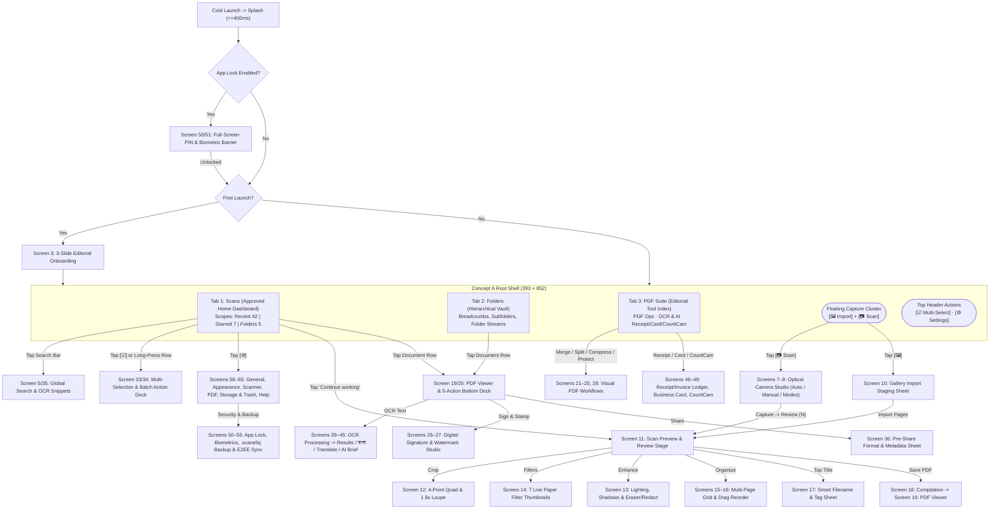

# Scaneliq — Navigation Architecture & Complete User Flows (Concept A Master)

**Document Date:** November 18, 2026  
**Approved Master Navigation:** **Concept A — 3-Destination Bottom Bar (`Scans`, `Folders`, `PDF Suite`) + Right-Thumb Floating Capture Cluster (`[Gallery]` + `[📷 Scan]`)**  
**Internal `Scans` Scopes:** **`Recent 42`** · **`Starred 7`** · **`Folders 5`**

---

## 1. Concept A Navigation Philosophy

As mandated in Section 11, Scaneliq preserves Concept A's calm, 3-destination navigation hierarchy—rejecting 5-tab super-app docks and central gradient buttons:

1. **Primary Bottom Navigation (`82px` Frosted Bar):**
   - **Tab 1 — `Scans` (Home Dashboard):** The editorial home stream featuring the search bar, internal document scopes (`Recent`, `Starred`, `Folders`), the `"Continue working"` draft folio card, and chronological monthly document streams.
   - **Tab 2 — `Folders` (Vault Hierarchy):** Dedicated hierarchical folder browser with monospaced breadcrumb trails (`VAULT / TAX & FINANCE`), subfolder creation, and folder-scoped streams.
   - **Tab 3 — `PDF Suite` (Productivity & Intelligence Workbench):** Hairline-organized editorial index of all PDF manipulation tools (`Merge`, `Split`, `Compress`, `Sign`, `Watermark`, `Protect & Redact`), OCR & AI tools (`OCR Text`, `বাংলা OCR`, `Translate`, `AI Brief & Q&A`), and specialized capture utilities (`Receipt & Invoice Ledger`, `Business Card Folio`, `ID Card 2-in-1`, `CountCam`).
2. **Right-Thumb Floating Capture Cluster (`bottom: 92px; right: 20px`):**
   - **`[📷 Scan]` (`50px` International Ultramarine pill):** Launches the full-screen Optical Camera Studio from anywhere in `Scans` or `Folders` in 1 tap.
   - **`[🖼]` (`46×46px` secondary circle):** Opens the Gallery & File Import staging sheet.
3. **Top Header Utilities (`40×40px` Circular Hit Targets):**
   - **`[☑]` (Multi-Select):** Activates in-place multi-selection mode and morphs the bottom bar into the 5-action Batch Dock (`Move`, `Tag`, `Merge PDF`, `Share`, `Trash`).
   - **`[⚙]` (Settings):** Opens the complete Editorial Settings & Security Vault hub.

---

## 2. Master Application Navigation Graph

---

## 3. Seven Complete User Journeys (Section 13 Verification)

### Journey 1 — Document Scanning (`Home → Scanner → Capture → Crop → Enhance → Organize → Export PDF → Save`)
1. **Home (`Scans`):** User taps the floating International Ultramarine **`[📷 Scan]`** pill (`bottom-right`).
2. **Scanner Camera (`Screen 7/8`):** Camera opens in `Auto` mode; `#3B82F6` quad locks onto the document and captures 4 pages into the bottom-left page stack (`04`). User taps **`Review (4) →`**.
3. **Scan Preview (`Screen 11`):** Shows Page 1 on the Gallery Alabaster/Carbon stage.
4. **Crop (`Screen 12`):** User taps **`Crop`**, drags the top-right handle using the **`1.8× Magnifying Loupe`**, and taps **`Apply Crop`**.
5. **Filters & Enhance (`Screens 13–14`):** User selects **`Magic Color`** from the 7 live paper thumbnails (with `Apply to all 4 pages` ON) and toggles `Flatten Paper Shadows`.
6. **Organize Pages (`Screens 15–16`):** User taps **`Organize`**, drags Page 03 ahead of Page 02, and taps **`Done`**.
7. **Export & Save (`Screens 17–19`):** User taps the title to apply Smart Token `Annual_Tax_Return_FY26`, taps **`Save PDF`**, watches the 3-step compilation sheet finish, and lands in **PDF Viewer (`Screen 19`)** with a searchable 4-page PDF committed to SQLite.

### Journey 2 — Document Management (`Home → Recent Documents → Document Preview → PDF Viewer → Share`)
1. **Home (`Scans` → `Recent 42`):** User scrolls to `Commercial Lease Agreement` (`PDF · 12P · 2.4 MB`).
2. **Document Preview (`Screen 32`):** Tapping `⋯` opens the Quick Action Drawer showing miniature preview, SHA-256 metadata link, and quick actions—or tapping the row directly opens **PDF Viewer (`Screen 19`)**.
3. **PDF Viewer (`Screen 19`):** User reads continuous A4 pages, jumps via the `01 / 12` pill, and taps **`↑ Share`** in the top-right header.
4. **Document Sharing (`Screen 36`):** User selects `Searchable PDF (2.4 MB)` and taps **`Share Document`**.

### Journey 3 — Folder Management (`Home → Folders → Open Folder → Select Documents → Batch Action`)
1. **Home (`Scans`):** User taps the **`Folders`** tab in the bottom bar (or the `Folders 5` scope tab).
2. **Folder Management (`Screen 30`):** User taps **`Tax & Finance (14 FILES)`**; breadcrumb updates to `VAULT / TAX & FINANCE`.
3. **Multi-Selection (`Screen 33`):** User taps `[☑]` in the header and selects 3 tax documents (`3 Selected`).
4. **Batch Action (`Screen 34`):** From the bottom Batch Dock (`Move | Tag | Merge PDF | Share | Trash`), user taps **`Merge PDF`** (or **`Move`**), immediately consolidating or relocating the 3 files.

### Journey 4 — OCR (`Document → OCR Processing → Extracted Text → Copy / Export`)
1. **PDF Viewer (`Screen 19`):** User taps **`OCR Text`** in the 5-action bottom dock.
2. **OCR Processing (`Screen 39`):** Optical scan line sweeps across the page (`RECOGNIZING TEXT · PAGE 1 OF 6`).
3. **OCR Results & Extracted Text (`Screens 40–42`):** User inspects interactive `#0052FF` word boxes at top and clean typographic paragraphs below (or switches to `বাংলা` numeral normalizer / `Translate` / `AI Summary`).
4. **Copy / Export:** User taps **`Copy All`** (or **`Export .txt`** / **`Embed Searchable PDF`**), triggering an editorial confirmation toast.

### Journey 5 — PDF Suite (`PDF Suite → Merge / Split / Compress → Preview → Export`)
1. **Bottom Bar:** User switches to Tab 3 (**`PDF Suite`**).
2. **Tool Selection:** User taps **`Split & Extract`** (or **`Merge PDFs`** / **`Compress PDF`**) from the hairline-divided editorial tool index.
3. **Visual Configuration (`Screens 21–23`):** User selects `Commercial Lease Agreement (12P)`, taps pages `01`, `02`, `03` in the visual miniature page grid (or selects `Balanced Archive -59%` in Compress), previews the estimated output, and taps **`Export PDF`** to open the result in PDF Viewer.

### Journey 6 — Security (`Settings → App Lock → Biometric Authentication → Security Settings`)
1. **Home Header:** User taps **`[⚙]`** to open **General Settings (`Screen 58`)** → taps **`Security & App Lock (`Screen 52`)`**.
2. **Security Settings:** User enables `App Lock (PIN)`, sets a 4-digit PIN (hashed via PBKDF2-HMAC-SHA256 100k iterations), enables `Biometric Unlock`, and sets `Auto-Lock Timeout` to `Immediately`.
3. **App Lock & Biometric Barrier (`Screens 50–51`):** User tests the lock screen barrier (`Lock Now` preview), verifying both the biometric prompt trigger and the tactile hairline PIN keypad.

### Journey 7 — Backup (`Settings → Backup and Restore → Select Destination → Backup Status`)
1. **Settings (`Screen 58`):** User taps **`Backup, Restore & Sync (`Screen 53`)`**.
2. **Backup Creation:** User reviews the Vault Summary Folio (`42 Documents · 5 Folders · AES-256-CBC + HMAC-SHA256 V2`), enters an encryption passphrase, and taps **`Create .scaneliq Backup Archive`**.
3. **Destination & Status:** Archive compiles with SHA-256 checksum verification (`SCANELIQ_ENC_V2`), displays the verified status card, and offers 1-tap `Save to Device / Share Archive` alongside transparent status for local E2EE sync envelopes (`Screen 54`).
